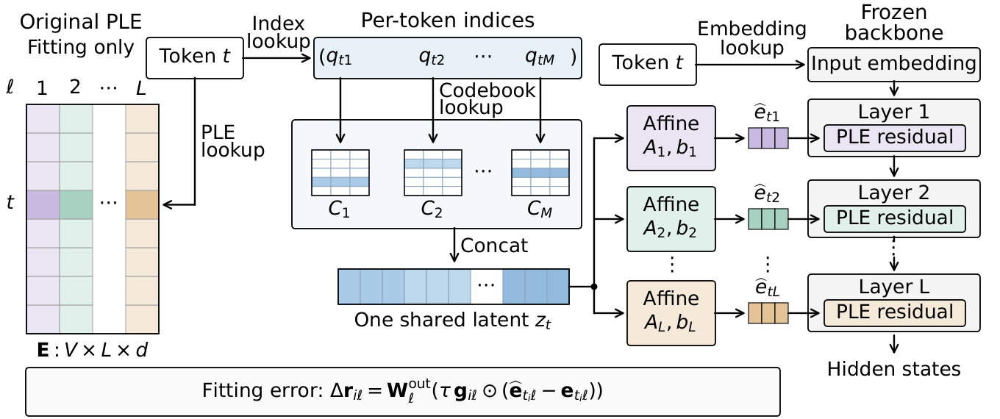

<h1 align="center">OPTIC</h1>

<p align="center">
  <strong>English</strong> · <a href="README.zh-CN.md">简体中文</a>
</p>

<p align="center">
  <strong>Extreme Compression of Per-Layer Embeddings<br>via Cross-Layer Latent Vector Quantization</strong>
</p>

<p align="center">
  Jiacheng Liu<sup>1</sup> · Yaxin Luo<sup>1</sup> · Xiaohan Zhao<sup>1</sup> · Peng Sun<sup>2,3</sup> · Xinyi Shang<sup>1,4</sup> · Jiacheng Cui<sup>1</sup> · Yonina C. Eldar<sup>5</sup> · Zhiqiang Shen<sup>1*</sup>
</p>

<p align="center">
  <sup>1</sup>Mohamed bin Zayed University of Artificial Intelligence · <sup>2</sup>Westlake University · <sup>3</sup>Zhejiang University<br>
  <sup>4</sup>University College London · <sup>5</sup>Weizmann Institute of Science<br>
  <sup>*</sup>Corresponding author
</p>

<p align="center">
  <a href="https://arxiv.org/abs/2610.31309"></a>
  <a href="https://huggingface.co/zcahjl3/gemma-4-E4B-it-OPTIC-100x"></a>
  <a href="#method-video"></a>
</p>

Gemma 4 E2B and E4B give every token a separate Per-Layer Embedding (PLE) vector
at each decoder layer. In E4B, PLE holds 35.2% of the parameters and takes 5.64 GB
in BF16. OPTIC (Output-Path-fitted, Token-shared Indexed Codes) stores one
quantized code tuple per token, shared by all layers, and reconstructs each
layer's vector with an affine decoder for that layer. Codes and decoders are
fitted to minimize error at the PLE output projection.

[](docs/figures/shared-codes.pdf)

<p align="center"><em>Figure 1. OPTIC shares each token's codes across layers and fits the reconstructed PLE contributions after the output projection.</em></p>

<a name="method-video"></a>
<details open>
<summary>Watch the method walkthrough · 2:56</summary>

https://github.com/user-attachments/assets/1d71b26f-c5ac-42fa-abb4-6c4f748cbcdc

</details>

## Contents

- [Highlights](#highlights)
- [Quick start](#quick-start)
- [Paper results](#paper-results)
- [Evaluate on the benchmarks](#evaluate-on-the-benchmarks)
- [Fit OPTIC](#fit-optic)
- [Repository](#repository)
- [Acknowledgements](#acknowledgements)
- [Citation](#citation)
- [License](#license)

## Highlights

- At about 100× PLE compression, OPTIC retains 97.8% of BF16 Gemma 4 E4B
  performance on seven benchmarks. Product quantization, the strongest of six
  conventional baselines, retains 66.3%.
- On the official W4A16 release of E4B, OPTIC retains 96.9% at the same rate.
- On BF16 E4B, OPTIC retains 90.5% at 594× and 84.1% at 1002×. At 1002×, the
  PLE of E4B takes 5.6 MB.
- Served from the 100× codes on one RTX 4090 with a fixed 1 GiB key-value cache,
  E4B uses 29.7% less GPU memory with BF16 weights and 43.1% less with W4A16
  weights. Wall time grows by at most 0.40% with BF16 and 0.69% with W4A16.

## Quick start

Use Python 3.12 and a CUDA GPU. A 24 GiB GPU accommodates BF16 Gemma 4 E4B
with OPTIC for the short generation examples below. Run these commands in a
Linux shell:

```bash
git clone https://github.com/VILA-Lab/optic.git
cd optic
python3.12 -m venv .venv
source .venv/bin/activate
python -m pip install -r requirements-inference.txt
python -m pip install -e .
python examples/generate.py --prompt "Explain why the sky is blue in two sentences."
```

The first run downloads the pinned model snapshot and the
[100× OPTIC artifact](https://huggingface.co/zcahjl3/gemma-4-E4B-it-OPTIC-100x).
Later runs reuse the cache. The answer is printed to standard output; timing
and GPU memory are printed to standard error.

For an image, use your own local file:

```bash
python examples/generate.py --image image.png --prompt "Describe this image."
```

To inspect codebook lookup and decoding on a small synthetic table, without
loading the model or using a GPU:

```bash
python examples/decode_optic.py
```

The decoded shape is `[3, 3, 16]`: three requested token rows, three layers,
and 16 values per layer. The core method is
[builders/methods/optic.py](builders/methods/optic.py); the compact decoder is
[compact_adapter.py](src/ple_eval/compact_adapter.py).

The model loader skips the original 5.64 GB PLE tensor and keeps 56.4 MB of
OPTIC tensors on the GPU. Requested token rows are decoded with one stacked
matrix multiplication. See the [deployment guide](docs/deployment.md) for local
checkpoint paths, vLLM generation and an OpenAI-compatible server.

## Paper results

At the nominal 100× tier, each cell gives retention in percent and, in
parentheses, the actual PLE compression ratio.

| Method | E2B BF16 | E4B BF16 | E2B W4A16 | E4B W4A16 |
| --- | ---: | ---: | ---: | ---: |
| *Baselines* | | | | |
| PQ | 22.9 (101.24×) | 66.3 (101.43×) | 0.0 (101.24×) | 82.4 (101.43×) |
| RVQ | 0.0 (100.96×) | 37.6 (98.64×) | 29.3 (100.96×) | 82.0 (101.20×) |
| OPQ-P | 0.0 (100.92×) | 52.4 (101.16×) | 0.0 (100.92×) | 57.9 (101.16×) |
| AQ | 0.0 (100.96×) | 45.6 (101.20×) | 0.0 (100.96×) | 62.8 (101.20×) |
| AQLM Euclidean beam encoder | 20.7 (100.96×) | 46.7 (101.20×) | 32.0 (100.96×) | 82.8 (101.20×) |
| INT8 randomized low-rank SVD | 0.0 (100.13×) | 37.7 (99.76×) | 0.0 (100.13×) | 51.1 (100.24×) |
| *Our methods* | | | | |
| Output-path-weighted PCA-PQ | 32.2 (96.14×) | 93.3 (96.36×) | 44.5 (96.14×) | 88.3 (96.36×) |
| OPTIC | 89.1 (99.86×) | **97.8** (99.94×) | 91.5 (99.86×) | **96.9** (99.94×) |
| Frequency-tiered OPTIC | **90.0** (100.48×) | 95.7 (100.00×) | **93.0** (100.48×) | 95.1 (100.00×) |

Retention compares each task score with the score of the same checkpoint using
uncompressed PLE. The per-task ratios are capped at 1 and combined by an
equal-weight geometric mean over the seven tasks: PIQA, GSM8K, GPQA Diamond,
AIME 2026, MMLU-Redux, IFBench and InfographicVQA.

```math
\mathrm{Retention} = 100\left[\prod_{k=1}^{7}\min\left(\frac{s_{m,k}}{s_{\mathrm{ref},k}},1\right)\right]^{1/7}
```

Here $s_{m,k}$ is the score of method $m$ on task $k$, and $s_{\mathrm{ref},k}$ is
the uncompressed score. Retention is 100% when no task score drops and 0 when any
task scores zero. The compression ratio is the size of the uncompressed BF16 PLE
divided by the bytes that the compressed PLE keeps in memory. The table uses
fitting seed 0, and its per-task scores are in [main-table.json](docs/figures/main-table.json).

[](docs/figures/rate-retention.pdf)

<p align="center"><em>Figure 2. PLE compression versus seven-benchmark performance retention on BF16 Gemma 4 E4B.</em></p>

On BF16 E4B, the PQ and OPQ-P baselines (dashed) fall to zero retention near
500× and 1000×.

## Evaluate on the benchmarks

The [released artifact](https://huggingface.co/zcahjl3/gemma-4-E4B-it-OPTIC-100x) is the seed-0 OPTIC fit for BF16 Gemma 4 E4B at
99.94× PLE compression, whose result is the 97.8% entry of the table above.
Install the evaluation environment with the [evaluation guide](docs/evaluation.md),
then run the seven benchmarks:

```bash
ple-eval evaluate --gpus 0 --run-id optic-e4b
```

The command loads the pinned checkpoint and the released artifact, prepares the
PLE reconstruction, runs the benchmarks, and writes the task scores and retention
to `results/optic-e4b/result.json`. The uncompressed reference scores are
included in [main-table.json](docs/figures/main-table.json).

Use `--model-dir /path/to/snapshot` to reuse a local checkpoint and
`--artifact /path/to/compressed_ple.npz` to reuse a downloaded artifact.
A small GPU text-and-image check is available with `--smoke --run-id optic-smoke`.

## Fit OPTIC

The [fitting guide](docs/fitting.md) prepares the calibration data and fits OPTIC
on BF16 Gemma 4 E4B with the settings of the released artifact.
[Method settings](docs/baselines.md) cover the other methods in the table.

## Repository

| Directory | Contents |
| --- | --- |
| [builders/methods](builders/methods) | OPTIC and output-path-weighted PCA-PQ fitting. |
| [builders/baselines](builders/baselines) | PQ, RVQ, PCA-PQ, and low-rank SVD implementations. |
| [src/ple_eval](src/ple_eval) | Compressed embedding decoders, the vLLM integration, and benchmark evaluation. |
| [scripts](scripts) | Calibration, fitting, and result aggregation commands. |
| [configs](configs) | Model, calibration, fitting, evaluation, and paper settings. |
| [data](data) | Fixed calibration inputs and benchmark request sets. |
| [examples](examples) | Generation with Transformers and vLLM, and CPU code-table decoding. |
| [docs](docs) | Inference, evaluation, and fitting guides, method settings, and figures. |

The core method is [builders/methods/optic.py](builders/methods/optic.py).
The decoding entry point is
[`load_compact_ple`](src/ple_eval/compact_adapter.py).

## Acknowledgements

This work is supported by the MBZUAI-WIS Joint Program for Artificial Intelligence Research.

The evaluation uses [vLLM](https://github.com/vllm-project/vllm),
[EvalScope](https://github.com/modelscope/evalscope), and the official
[IFBench scorer](https://github.com/allenai/IFBench). The AQLM baseline uses the
[authors' beam-search implementation](https://github.com/Vahe1994/AQLM).
Attribution and licenses for included third-party material are in
[THIRD_PARTY_NOTICES.md](THIRD_PARTY_NOTICES.md).

## Citation

If you use OPTIC, please cite:

```bibtex
@misc{liu2026extremecompressionperlayerembeddings,
      title={Extreme Compression of Per-Layer Embeddings via Cross-Layer Latent Vector Quantization},
      author={Jiacheng Liu and Yaxin Luo and Xiaohan Zhao and Peng Sun and Xinyi Shang and Jiacheng Cui and Yonina C. Eldar and Zhiqiang Shen},
      year={2026},
      eprint={2610.31309},
      archivePrefix={arXiv},
      primaryClass={cs.LG},
      url={https://arxiv.org/abs/2610.31309},
}
```

## License

The OPTIC code is released under the [Apache License 2.0](LICENSE).
